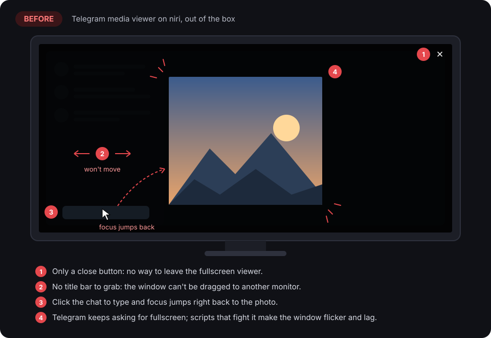
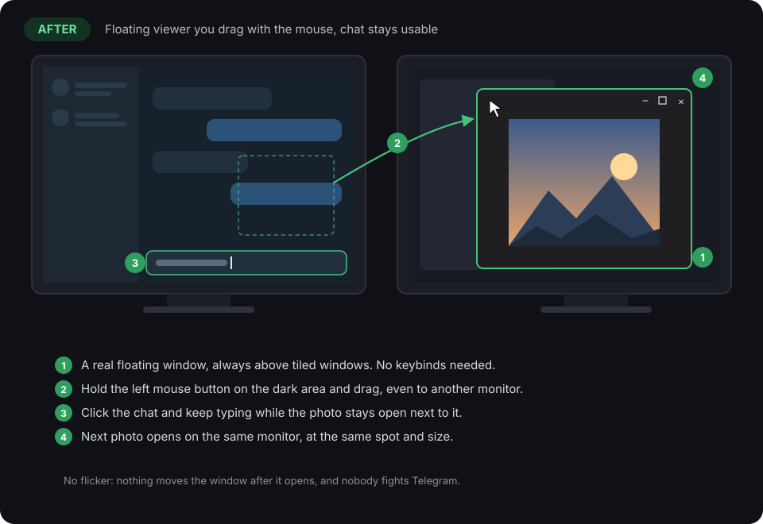
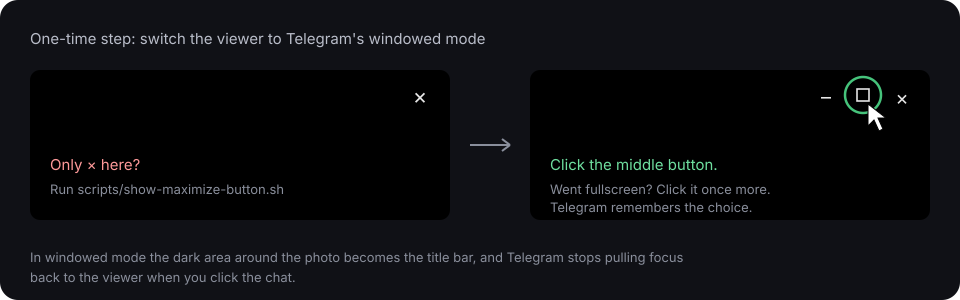

# Telegram media window fix for niri

[Русская версия](README.ru.md)

Make the Telegram Desktop media viewer behave on [niri](https://github.com/niri-wm/niri)
the way it does on Windows: a normal floating window above everything else
that you drag around with the mouse (to any monitor), while you keep typing in
the chat. It reopens on the same monitor, at the same spot and size.

| Before | After |
| --- | --- |
|  |  |

## What was wrong

* **Only a close button, no way to drag.** The viewer is in Telegram's
  fullscreen mode. Its window buttons follow the desktop button layout, and
  the common default `appmenu:close` shows only ×, so you can't switch to
  windowed mode. niri draws no title bars, so there is nothing to grab either.
* **Focus keeps jumping back to the photo.** While the viewer is "fullscreen"
  on the same monitor as the chat, Telegram re-activates the viewer whenever
  you click the main window.
* **Flicker and lag.** Telegram keeps asking niri for fullscreen. Workarounds
  that force the window back to floating end up in an endless fight with it.
* **It always opens in the middle of the current monitor.** Telegram creates a
  brand new viewer window every time, and a Wayland app can't choose its own
  position.

## How the fix works

1. **Windowed mode in Telegram (one click, once).** Telegram's viewer has a
   proper windowed mode: it stops requesting fullscreen, stops stealing focus,
   and treats the dark area around the photo as a title bar. Pressing there
   starts a normal compositor move (`xdg_toplevel.move`), which niri supports
   for floating windows, across monitors too.
2. **A niri window rule** opens the viewer as a floating window (always drawn
   above tiled windows) and refuses the initial fullscreen/maximize request.
3. **`telegram-media-place`**, a tiny user service. When the viewer closes it
   writes its monitor, position and size into `~/.config/niri/telegram-media.kdl`
   (`open-on-output` + `default-floating-position` + fixed size). niri reloads
   the file by itself, so the next viewer **opens** in place. Nothing moves
   the window after it appears, so the cursor never jumps and there is no
   fight with Telegram. It holds one IPC socket to niri: no polling, no
   subprocesses.

## Requirements

* niri with `include` support in the config (tested on niri 26.04)
* Telegram Desktop (tested on 7.3.1, native or Flatpak, app id `org.telegram.desktop`)
* `python3`, a systemd user session
* `gsettings`, only if your viewer shows just the × button (see step 2)

## Install

```bash
git clone https://github.com/freakkxd/Telegram-Media-Window-Niri-Fix-tmwnf-
cd Telegram-Media-Window-Niri-Fix-tmwnf-
./install.sh
```

The installer:

* backs up your `config.kdl` (`config.kdl.bak-telegram-media-<date>`);
* installs `~/.local/bin/telegram-media-place` and the
  `telegram-media-place.service` user unit, and enables it;
* appends the rule block from [`niri/telegram-media-viewer.kdl`](niri/telegram-media-viewer.kdl)
  to your config, between `>>> telegram-media-window-niri-fix >>>` markers;
* runs `niri validate` and restores the backup if niri rejects the result.

### One-time step: switch the viewer to windowed mode



1. Open any photo in Telegram and move the mouse: the window buttons appear in
   the top right corner. Click the middle (maximize/restore) one.
2. If the viewer went fullscreen, click it once more: now it is a window.
   Telegram remembers the choice.

Only × there? Your button layout hides the other buttons. Run this, follow
the prompt, and it puts your layout back afterwards:

```bash
./scripts/show-maximize-button.sh
```

## Usage

* **Move:** hold the left mouse button on the dark area around the photo and
  drag, to any monitor. The photo itself and the controls keep their usual
  clicks.
* **Resize:** niri's `Mod` + right mouse button drag. The size is remembered too.
* **Chat while viewing:** just click the chat and type, the viewer stays open.
* **Reopen:** the next photo or video opens where you closed the last one.

## Telegram in another language

The rule matches the viewer by its window title: `Media viewer` (English)
and `Просмотр медиа` (Russian) out of the box. For another language, open a
photo and look up the title:

```bash
niri msg windows
```

Then install with your title added (it is a regular expression):

```bash
TG_MEDIA_TITLE_RE='^(Media viewer|Your title here)$' ./install.sh
```

If you installed before, run `./uninstall.sh` first so the config block is
rewritten with the new title.

## Uninstall

```bash
./uninstall.sh
```

This removes the service, the script, the block in `config.kdl` (after
backing it up) and `telegram-media.kdl`. To return the viewer to fullscreen
mode, click its maximize button again.

## Troubleshooting

```bash
systemctl --user status telegram-media-place
journalctl --user -u telegram-media-place -f
cat ~/.config/niri/telegram-media.kdl
```

* **The viewer still opens fullscreen.** It is not in windowed mode yet, see
  the one-time step.
* **It opens in the middle of the monitor.** Nothing has been saved yet: close
  the viewer once after moving it. Also check that the title regex matches
  (`niri msg windows`).
* **The saved monitor is unplugged.** niri opens the viewer on the current
  monitor instead.

## Limitations

* niri has no "show on all workspaces": the viewer belongs to the workspace it
  is on. Switch that monitor to another workspace and the viewer goes with it.
* niri only draws its focus ring and border, no title bar. The viewer is moved
  by its dark area, not by a title bar.

## Files

| Path | What it is |
| --- | --- |
| [`bin/telegram-media-place`](bin/telegram-media-place) | The service: remembers monitor, position and size |
| [`systemd/telegram-media-place.service`](systemd/telegram-media-place.service) | systemd user unit |
| [`niri/telegram-media-viewer.kdl`](niri/telegram-media-viewer.kdl) | Rule block appended to `config.kdl` |
| [`install.sh`](install.sh), [`uninstall.sh`](uninstall.sh) | Install and remove |
| [`scripts/show-maximize-button.sh`](scripts/show-maximize-button.sh) | Temporarily shows the viewer's maximize button |

## License

[MIT](LICENSE)
